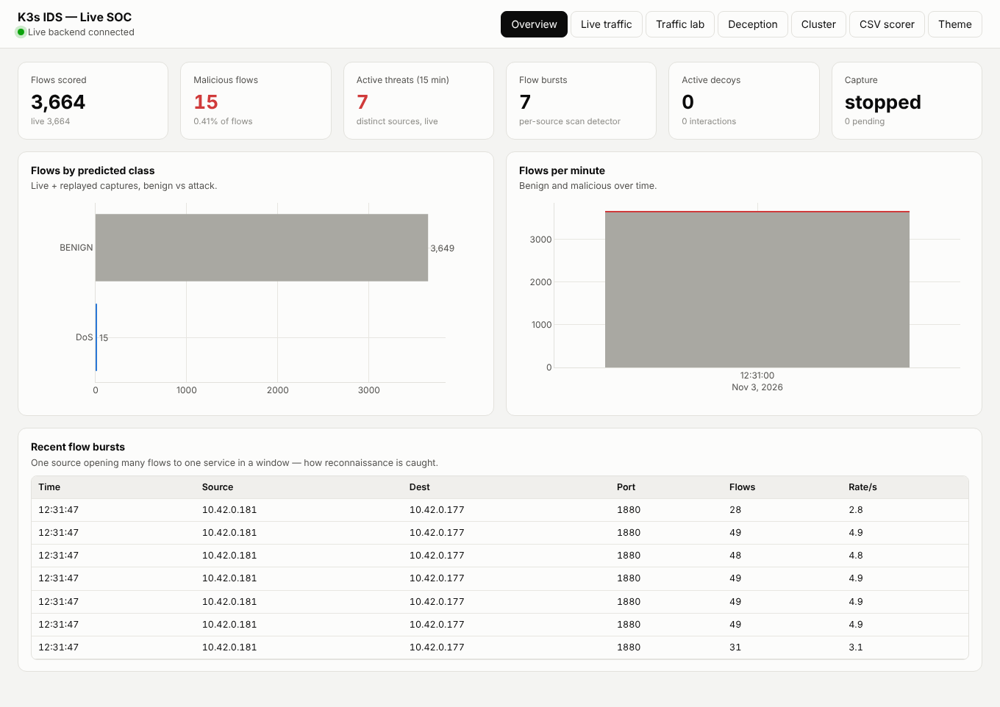

# Kubernetes (K3s) intrusion detection & deception

A machine-learning IDS for a K3s cluster. It trains on CIC-IDS2017 flow features,
captures live pod traffic, scores every flow, detects reconnaissance by flow
bursts, and runs a MAPE-K controller that deploys isolated decoys for confident
attacks — all driven from a web dashboard, including a traffic lab that generates
the attack traffic to test detection.



## Two ways to use it

1. **CSV scorer** (`/`) — drop a CICFlowMeter CSV and see per-flow predictions,
   confidence, charts and model performance. No cluster needed.
2. **Live SOC** (`/live`) — live capture, the traffic lab, the deception
   controller and cluster status. Needs a K3s cluster and CICFlowMeter.

## Layout

```
ml/                      training pipeline (prepare.py, train.py, augment_lab.py)
models/
  cic-ids2017/           CIC-only Random Forest (used by the CSV scorer)
  cic-ids2017-lab/       + verified lab benign traffic (used by the live pipeline)
dashboard/
  app.py                 FastAPI app: CSV scorer + live endpoints (live_api.py)
  static/index.html      CSV scorer page
  static/live.html       live SOC dashboard
live/                    live pipeline: capture, CICFlowMeter, scoring, flow bursts,
                         MAPE-K deception controller, traffic-lab launcher
deploy/
  namespaces/            ids-traffic, ids-deception
  traffic-lab/           generator script, Job template, NetworkPolicy, kustomization
  deception/             decoy server, template, profiles, NetworkPolicy
  rbac/                  least-privilege identity + kubeconfig script
data/
  cic-ids2017/           big training CSV (git-ignored, see data/README.md)
  k8s/                   cluster captures; lab-benign/ used for augmentation
config/live.yaml         all live-pipeline tunables
docs/                    architecture and the run guide
```

## Quick start (CSV scorer)

```bash
python -m venv .venv
source .venv/bin/activate            # Windows: .venv\Scripts\activate
pip install -r requirements.txt
cd dashboard && uvicorn app:app --port 8000      # open http://localhost:8000
```

The live SOC page is at `/live`. Running it against a real cluster needs a few
one-time steps (tcpdump capability, CICFlowMeter, the RBAC identity, the lab
manifests) — see **[docs/live-system.md](docs/live-system.md)**.

## Models (held-out 30% CIC-IDS2017 test split, 659,502 flows)

| Model | Macro F1 | Attack detection | False alarms (CIC) | False alarms (K3s lab benign) |
|---|---|---|---|---|
| Random Forest — cic-ids2017 | 0.9521 | 99.72% | 0.085% | 0.97% |
| **Random Forest — cic-ids2017-lab** | 0.9522 | 99.73% | 0.089% | **0.28%** |
| LightGBM | 0.9519 | 99.97% | 0.094% | — |
| XGBoost | 0.9519 | 99.96% | 0.099% | — |
| Naive Bayes | 0.3233 | 99.36% | 50.7% | — |

Bot is the weakest class (F1 ≈ 0.72). Adding this cluster's benign traffic cuts
false alarms 3.5× with no change to the CIC benchmark. Per-class details:
[models/cic-ids2017/RESULTS.md](models/cic-ids2017/RESULTS.md).

## How detection works

- **The model** classifies each flow into BENIGN or one of six attack families
  (DoS, DDoS, PortScan, BruteForce, WebAttack, Bot). It is strong on volumetric
  and payload-bearing attacks.
- **The flow-burst detector** catches reconnaissance, which the model cannot:
  one scan request looks like one benign request, but a scan opens many flows
  from one source to one service in a window. Both feed the controller.
- **The MAPE-K controller** deploys decoys for confident attacks and for flow
  bursts, mapped to the attack class or the targeted port. Benign traffic never
  triggers a decoy.

## Credit

The live capture, flow-burst and MAPE-K deception design are adapted from
[rithwik1407/k8s-security-system](https://github.com/rithwik1407/k8s-security-system)
(`k8s-adaptive-ids`). This repo pairs that design with the stronger CIC-IDS2017
model, a richer dashboard, and a UI-driven traffic lab for the attacks the model
detects.
