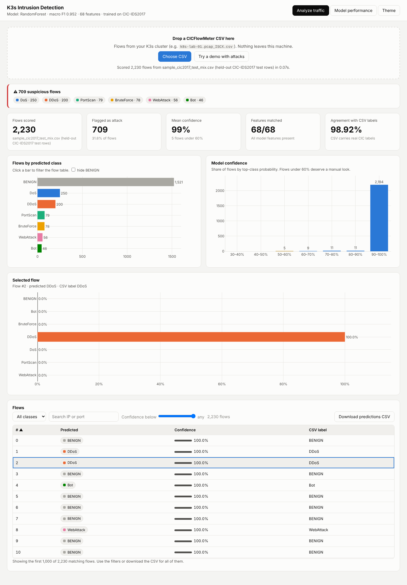

# Kubernetes (K3s) intrusion detection

A machine-learning IDS for a K3s cluster: it trains on CIC-IDS2017 flow features and scores CICFlowMeter captures from the cluster in an interactive dashboard.



## Layout

```
ml/                     training pipeline
  prepare.py            clean CIC-IDS2017, group labels, map CICFlowMeter column names
  train.py              train RF / Naive Bayes / LightGBM / XGBoost, save the best
models/cic-ids2017/     trained model (best_model.joblib), metrics, confusion matrices, RESULTS.md
dashboard/              FastAPI app + interactive web page for scoring CSVs
  app.py
  static/               index.html + bundled Plotly (works offline)
  sample_cic2017_test_mix.csv   demo flows with attacks (held-out test rows)
data/                   datasets (big CIC CSV is git-ignored, see data/README.md)
  k8s/                  CICFlowMeter captures from the K3s lab
experiments/window-level/   earlier experiment: window/channel-level features
docs/screenshots/
```

## Quick start

```bash
python -m venv .venv
source .venv/bin/activate            # Windows: .venv\Scripts\activate
pip install -r requirements.txt

# Run the dashboard with the trained model
cd dashboard
uvicorn app:app --port 8000          # open http://localhost:8000
```

## Retrain

```bash
python ml/prepare.py data/cic-ids2017/merged.csv out/
python ml/train.py out/
# copy out/best_model.joblib, metrics.json and cm_*.png to models/cic-ids2017/
```

## Results (held-out 30% test split, 659,502 flows)

| Model | Macro F1 | Attack detection | False alarms |
|---|---|---|---|
| Random Forest (in use) | 0.9521 | 99.72% | 0.085% |
| LightGBM | 0.9519 | 99.97% | 0.094% |
| XGBoost | 0.9519 | 99.96% | 0.099% |
| Naive Bayes | 0.3233 | 99.36% | 50.7% |

Bot is the weakest class (F1 about 0.72). Details are in [models/cic-ids2017/RESULTS.md](models/cic-ids2017/RESULTS.md).
